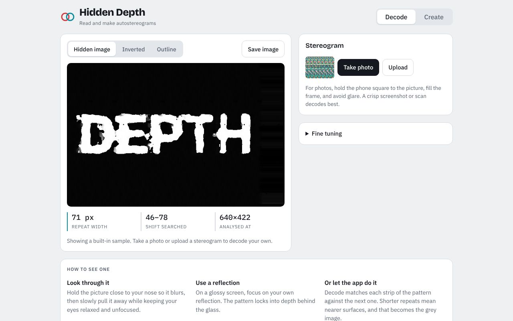

# NotSoMagicEye

<!-- site-screenshot: docs/screenshot.jpg -->

A phone-friendly web app for autostereograms (the "hidden 3D picture" posters). Everything runs in the browser; no images leave your device.

**Live site:** https://mendus59.github.io/NotSoMagicEye/

## Decode
Take a photo with your phone camera or upload an image. The app:

1. Finds the pattern's repeat width by comparing the picture with horizontally shifted copies of itself.
2. For every pixel, searches nearby shifts for the best colour match (box-filtered, sub-pixel refined). A shorter repeat means a nearer surface.
3. Shows the result as a grey depth image, an inverted version, or an "outline" view (difference at the base repeat).

Use **Fine tuning** to set the repeat width by hand, change smoothing, or widen the depth search if a photo decodes poorly. Straight-on, glare-free photos or screenshots work best.

## Create
Pick hidden text, a built-in shape, or upload your own image (bright = near). Choose a generated background (static, pebbles, marble, confetti) or use a photo as the texture, then save the PNG. Supports wall-eyed and cross-eyed output, depth strength, repeat count and output size. Generation uses the symmetric linking method with hidden-surface removal.

## Hosting
It is a single static `index.html`. A GitHub Actions workflow (`.github/workflows/pages.yml`) deploys it to GitHub Pages on every push to `main` (repo Settings → Pages → Source must be "GitHub Actions"); any static host (Netlify, Cloudflare Pages, a USB stick) works the same way.
